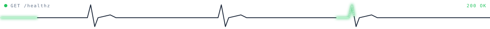
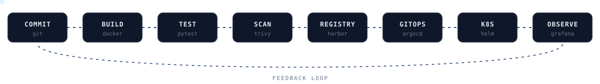

  

 

  

## 🟢 Components

> Every service below is **operational**. Uptime is self-reported and may be influenced by coffee.

<h4>🟢 Cloud & Virtualization &nbsp;·&nbsp; Operational &nbsp;·&nbsp; 99.99%</h4>

  
  
  
  
  
  
  
  
  

<h4>🟢 Containers, Orchestration & Service Mesh &nbsp;·&nbsp; Operational &nbsp;·&nbsp; 99.99%</h4>

  
  
  
  
  
  
  
  
  
  

<h4>🟢 Infrastructure as Code & Config Management &nbsp;·&nbsp; Operational &nbsp;·&nbsp; 99.98%</h4>

  
  
  
  
  
  
  
  
  

<h4>🟢 CI/CD & GitOps &nbsp;·&nbsp; Operational &nbsp;·&nbsp; 99.99%</h4>

  
  
  
  
  
  
  
  
  
  
  

<h4>🟢 Monitoring, Logging & Observability &nbsp;·&nbsp; Operational &nbsp;·&nbsp; 99.999%</h4>

  
  
  
  
  
  
  
  
  
  

<h4>🟢 Networking, Balancing & Security (DevSecOps) &nbsp;·&nbsp; Operational &nbsp;·&nbsp; 99.98%</h4>

  
  
  
  
  
  
  
  
  
  

<h4>🟢 Databases, Caching & Message Brokers &nbsp;·&nbsp; Operational &nbsp;·&nbsp; 99.97%</h4>

  
  
  
  
  
  
  
  
  

<h4>🟢 Scripting, Languages & OS &nbsp;·&nbsp; Operational &nbsp;·&nbsp; 99.99%</h4>

  
  
  
  
  
  
  
  
  

<h4>🟡 Currently in rollout &nbsp;·&nbsp; Partial rollout &nbsp;·&nbsp; learning</h4>

  
  
  

---

## 🔁 Delivery pipeline

---

 

> **Postmortem** &nbsp;·&nbsp; **Root cause:** it was DNS. &nbsp;·&nbsp; **Action items:** automate it, document it, monitor it.

  <code>echo "Have a nice deployment!" | wall</code>

  
  

